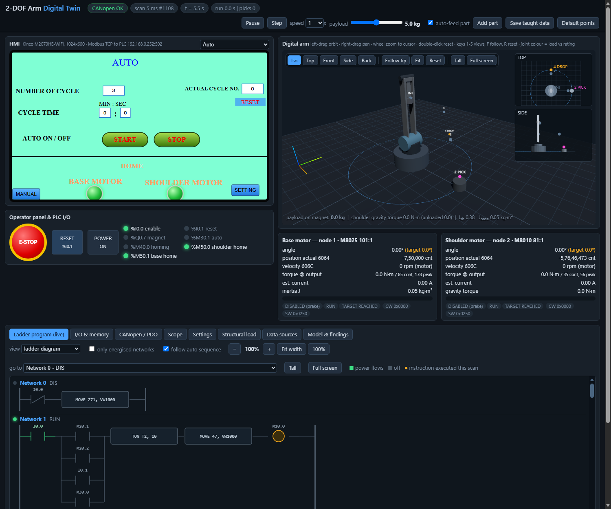

# PLC-controlled 2-DOF manipulator: hardware, ladder, HMI and digital twin

A pick-and-place arm (base yaw + shoulder pitch, 420 mm reach, 5 kg electromagnet payload) driven by a Kinco PLC over CANopen, operated from a Kinco HMI. This repository holds the design documents, the PLC and HMI project files, and a **digital twin** that runs the real ladder program in Python together with simulated drives, arm dynamics and HMI, with a web UI and a three.js view of the arm.

| Part | Model |
|---|---|
| PLC | Kinco K615S-16DT (8 DI / 8 DO, Ethernet, CAN master) |
| HMI | Kinco M2070HE-WIFI (7", 1024x600, Ethernet) |
| Base motor | M8025(B)E25B101L, harmonic drive 101:1 |
| Shoulder motor | M8010(B)E17B81L, harmonic drive 81:1 |

Details: [docs/HARDWARE.md](docs/HARDWARE.md).


## Quick start (digital twin)
```
python -m venv .venv && .venv\Scripts\activate         # first time only
pip install -r requirements.txt                          # the twin core needs nothing; extras are for live PLC / mocap / sensors
python run_twin.py                                       # opens http://127.0.0.1:8765
python run_tests.py                                      # all tests (about 80 s)
```
In the browser: press **START** on the HMI's Auto screen to run the 3-cycle pick-and-place, drag the 3D view to orbit. How to use every tab: [docs/USER_GUIDE.md](docs/USER_GUIDE.md).

## Run it without any hardware (showcase mode)
The twin is self-contained: no PLC, HMI panel, camera or sensors needed, and the core needs no packages beyond Python 3.10+.
```
python run_twin.py --demo        # loops the 3-cycle pick-and-place by itself; click anywhere to take over
python run_twin.py               # normal mode: press START on the on-screen HMI yourself
```

Navigation: 3D view has Iso/Top/Front/Side/Back, Follow tip, Fit, Reset and full screen (keys 1-5, F, R); the ladder scrolls both ways, drags to pan and zooms. Hardware parts (`live/`, `mocap/`) are optional plug-ins; a test (`tests/test_standalone.py`) fails if the twin ever depends on them.

## What is in here
```
twin/            the digital twin: PLC interpreter, drives, arm physics, HMI, web server and UI (twin/web)
live/            read-only live PLC feed (Modbus TCP) and motor-sensor input
mocap/           motion capture from camera images (ArUco tags)
tools/           calibration, CAD import, run comparison, tag printing, demos
firmware/        ESP32 sketch for the motor current/voltage sensors (untested on hardware)
tests/           unit tests, HTTP tests, browser smoke test
docs/            documentation (index: docs/README.md), paper, website, vendor manuals, drawings
project_files/   KincoBuilder / KincoDTools project backups and the drive EDS file
```

## Documentation
Start with [docs/README.md](docs/README.md). Highlights: [ARCHITECTURE](docs/ARCHITECTURE.md), [USER_GUIDE](docs/USER_GUIDE.md), [HARDWARE](docs/HARDWARE.md), [PLC program, CANopen and memory map](docs/PLC_Program_and_Communication.md), [findings from running the real ladder](docs/PLC_FINDINGS.md), [build plan and status](docs/BUILD_PLAN.md).

## Status and honesty notes
The twin has been tested against itself, simulated feeds and rendered images only. It has **not** been connected to the real PLC, drives, a camera, motor sensors or the CAD model yet; those steps are written up in [docs/BUILD_PLAN.md](docs/BUILD_PLAN.md). Many physical parameters are placeholders tagged `[assumed]` in `twin/config.py`. The live PLC reader is read-only by construction.

## License
See [LICENSE](LICENSE).
