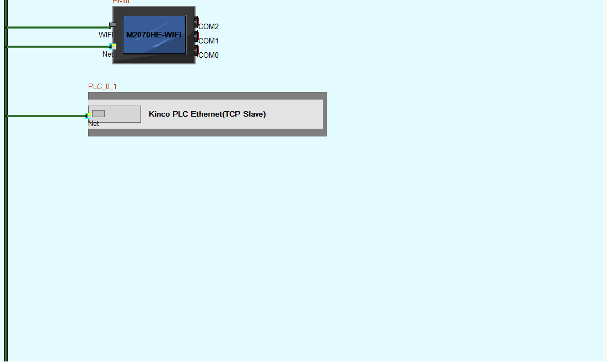
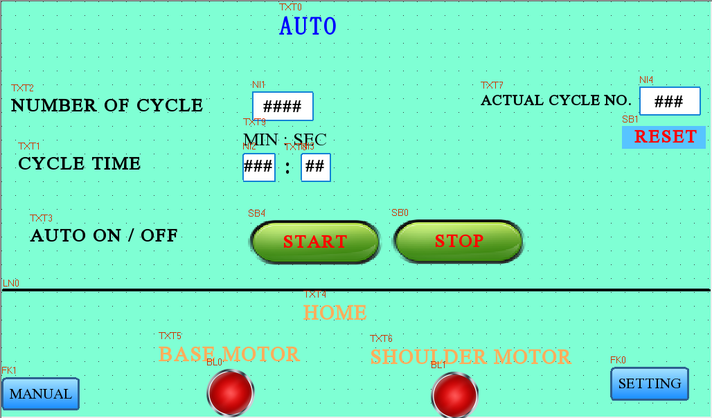
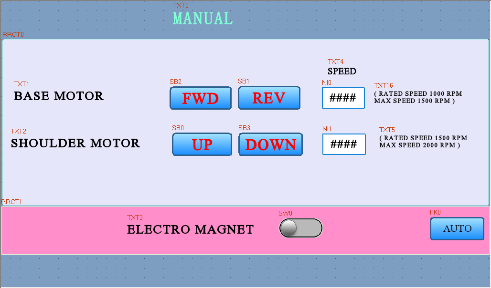
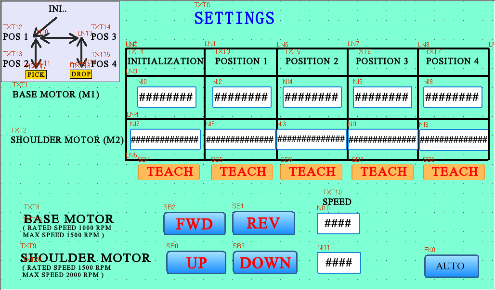
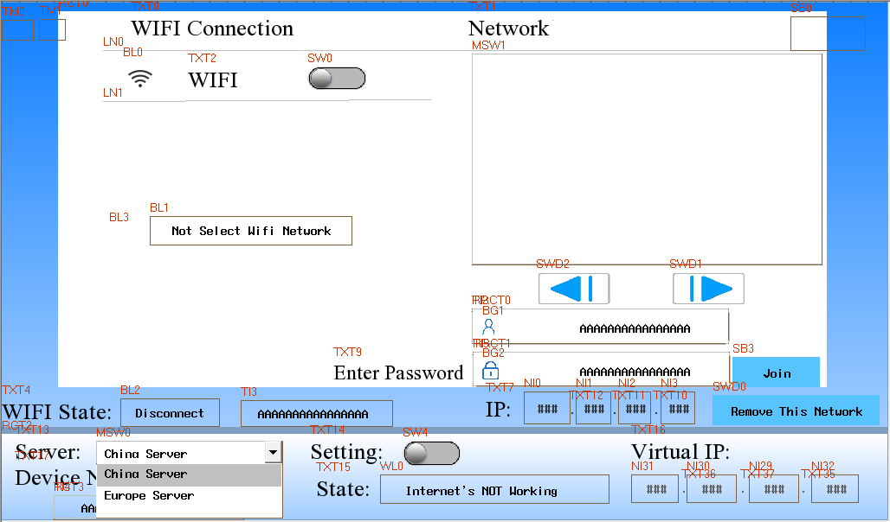
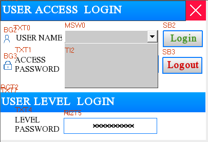

# PLC Program, CANopen and Memory Map (extracted from `PLC and HMI/PLC`)

Source: `Desktop\PLC and HMI\PLC\PLC.kpr` + `PLC\MAIN_MAIN.ilp` (KincoBuilder V8.5).
Extracted by reading the project files directly (not from screenshots of the IDE).
Items marked **[verify]** should be confirmed in KincoBuilder.

## 1. Hardware / project
| Item | Value |
|---|---|
| CPU | Kinco K615S-16DT (24 VDC, 8 DI / 8 DO, 1 Ethernet) |
| Programs | `MAIN` (Networks 0-38, IL), `SBR_0`, `SBR_1` (empty) |
| Timers/counters | T1 TOF, T2 TON, T3 TON, T4 TOF, T5 TOF, T6 TOF, T21 TON, T22 TON, T23 TON, T25 TON, T26 TON, C2/C3/C4 CTU |

## 2. Communication settings

### 2.1 CANopen master (PLC <-> two joint drives)
| Setting | Value |
|---|---|
| Master node address | 127 |
| CANopen baud rate | **1000 kbps** (confirmed in KincoBuilder; must equal drive baud) |
| SDO timeout | 60 ms |
| Startup | "Configure slaves at startup" ticked, power-on delay 3 s |
| Slave error control | Heartbeat, producer 500 ms, consumer 600 ms, error treatment "Stop the node" |
| Status words | NetStates 1000, MasterStates 1010, AllSlaveStates 1030 **[verify]** |
| Slave 1 (base) | Node 1, device "AIM" (Type 131474), heartbeat 500 ms, node time 1000 ms |
| Slave 2 (shoulder) | Node 2, same device/type and timing |
| PDO transmission | Type 255, no inhibit time |
| PLC as CANopen slave | Disabled |

### 2.2 PDO mapping and PLC memory
| Node | PDO | COB-ID | Object | PLC address | Bits |
|---|---|---|---|---|---|
| 1 | RPDO1 | 0x201 | 6040 Controlword | %VW1000 | 16 |
| 1 | RPDO1 | 0x201 | 6060 Modes of operation | %VB1010 | 8 |
| 1 | RPDO2 | 0x301 | 607A Target position | %VD1002 | 32 |
| 1 | RPDO2 | 0x301 | 60FF Target velocity | %VD1006 | 32 |
| 1 | RPDO3 | 0x401 | 6083 Profile acceleration | %VD1014 | 32 |
| 1 | TPDO1 | 0x181 | 6041 Statusword | %VW1012 | 16 |
| 1 | TPDO1 | 0x181 | 6060 Modes of operation | %VB1011 | 8 |
| 1 | TPDO2 | 0x281 | 6064 Position actual | **%MD600** | 32 |
| 1 | TPDO2 | 0x281 | 606C Velocity actual | %VD1018 | 32 |
| 1 | TPDO3 | 0x381 | 6078 Current actual | %VW1022 | 16 |
| 2 | RPDO1 | 0x202 | 6040 Controlword | %VW1024 | 16 |
| 2 | RPDO1 | 0x202 | 6060 Modes of operation | %VB1026 | 8 |
| 2 | RPDO2 | 0x302 | 607A Target position | %VD1028 | 32 |
| 2 | RPDO2 | 0x302 | 60FF Target velocity | %VD1032 | 32 |
| 2 | RPDO3 | 0x402 | 6083 Profile acceleration | %VD1036 | 32 |
| 2 | RPDO3 | 0x402 | 260A Electronic gear numerator | %VW1040 | 16 |
| 2 | TPDO1 | 0x182 | 6041 Statusword | %VW1042 | 16 |
| 2 | TPDO1 | 0x182 | 6060 Modes of operation | %VB1027 | 8 |
| 2 | TPDO2 | 0x282 | 6064 Position actual | %VD1044 | 32 |
| 2 | TPDO2 | 0x282 | 606C Velocity actual | %VD1048 | 32 |
| 2 | TPDO3 | 0x382 | 607A Target position (readback) | %VD1052 | 32 |

Node 1 position lands in `%MD600` while node 2 position lands in `%VD1044`; the program uses exactly these two addresses as feedback.

Controlword values written: `271` (0x010F), `47` (0x002F), `15` (0x000F). Modes of operation (%VB1010 / %VB1026) is mapped but **not written by the program**, so the drive must already be in position mode (drive config/SDO) **[verify]**.

### 2.3 What must match on the drive side
- Node IDs 1 and 2 and the same CAN baud rate as the PLC.
- PDO COB-IDs and mappings as in 2.2 (override the drive defaults).
- Heartbeat/guard timing: 500 ms heartbeat, 1000 ms node time (PLC overtime 600 ms).
- Drive EDS in repo: `_MOTOR_SN2.eds`; manual: `docs/CANOPEN Mannual_v1_6 M series Robot Joint Module_.pdf`.

### 2.4 Ethernet (PLC <-> HMI / PC)
| Setting | Value |
|---|---|
| PLC IP | 192.168.0.252 |
| Subnet mask | 255.255.255.0 |
| Gateway | 192.168.0.1 |
| Port | 502 (Modbus TCP) |
| Timeout / retry | 2000 ms / 0 |

The HMI must be on 192.168.0.x/24 (not .252) and point at 192.168.0.252:502.

### 2.5 Serial ports
Confirmed in KincoBuilder (Hardware > Comm): Port0 115200 8N1 station 1; Port1 (RS485) and Port2 (RS485) 9600 8N1 station 1, Modbus master off, timeout 300 ms; Port3 unused. Only relevant if the HMI is wired by serial.

## 2.7 Screenshots (KincoBuilder V8.5.0.7)
All in `docs/img/plc/`: `kincobuilder_hardware_io.png`, `_hardware_comm.png`, `_hardware_others.png`, `_hardware_retentive.png`, `_canopen_network.png`, `_canopen_global.png`, `_canopen_mapping.png`, `_canopen_summary.png`, `_tcpip.png`; ladder diagram, captured at full resolution (Networks 0-38): `ladder_left_01.png` ... `ladder_left_10.png` show the left part of every network, top to bottom (about 5 networks per image); `ladder_right_01.png` ... `ladder_right_06.png` show the right part (coils and last blocks) of the wide networks, with the same vertical positions as left images 6-10. Left and right images overlap horizontally.

### 2.6 Other
HSC0 enabled (others disabled, not used by the logic). Analog channels unused.

## 3. I/O and key memory (inferred from logic and comments)
| Address | Meaning |
|---|---|
| %I0.0 | Master enable (everything gated by it; low => controlword 271) |
| %I0.1 | Stop/reset-type input (forces run, triggers homing in Network 13) |
| %Q0.7 | Electromagnet output |
| %M20.1 / M20.2 | Base: manual jog / manual position |
| %M20.3 / M20.4 | Shoulder: manual jog / manual position |
| %M20.5 | Manual electromagnet |
| %M22.0-22.4 | HMI teach points 1-5 |
| %M30.0 | Auto start; %M30.1 auto running; %M30.2 stop/complete; %M30.4 counter reset; %M30.6 auto magnet |
| %M31.0-31.7, %M32.0-32.2 | Auto sequence step flags |
| %M40.0 | Homing in progress; %M50.0 shoulder home; %M50.1 base home |
| %VD2020 / %VD2030 | Speed set-points (base / shoulder) from HMI |
| %VD2300-2316 | Taught base positions (points 1-5) |
| %VD2400-2416 | Taught shoulder positions (points 1-5) |
| %VW2036 | Cycle target count (HMI) |
| %VW2400 / 2500 / 2510 | Cycle counter mirrors (C2 / C3 / C4) |
| %VD3000-3110 | Scratch for +/-2000-count in-position windows |

Note: %VW2400 overlaps %VD2400 (shoulder point 1), because VD2400 occupies VW2400-2401. Counter mirror C2 -> %VW2400 will corrupt the taught position. **[verify]**

## 4. Program flow (`MAIN`, 39 networks)
- **N0-2, N6-8, drive enable.** %I0.0 off => controlword 271. On with a request => TON (T2/T3) then 47; off-delay TOF (T1/T4) then 15.
- **N3-5, N9-11, manual jog.** Fixed jog targets (base -750000 / +3000000; shoulder -57646473 / -58321097) with speed from HMI. With no request the target follows feedback (hold).
- **N12, teach.** M22.0-4 copy current feedback into the 5 stored points.
- **N13-16, homing.** Move to home targets; M50.0 when VD1044 > -57648500, M50.1 when MD600 < -745000; clears step flags.
- **N17, magnet.** Q0.7 = M20.5 OR M30.6.
- **N18, auto latch.** Needs both axes at home.
- **N19-20, 36-38, counters.** C4 ticks, C3 chains from C4, C2 counts cycles; M30.4 resets.
- **N21-27, sequence steps.** Load taught pairs, build +/-2000-count windows, set the next step when both axes are in window. Magnet on at step 3, T21 delay, release at step 6.
- **N28-31, place and cycle count.** T22/T23 delays, C2 counts cycles; M30.2 when C2 >= VW2036.
- **N32-35, finish and return,** clear step flags.

## 5. Things to fix or confirm
1. Networks 12 and 13 have `MOVE` / `AND(` constructs nested inside `OR(` that look like a decompile artefact of ladder branches; confirm in KincoBuilder.
2. VW2400 / VD2400 overlap (section 3).
3. Jog and home constants are raw encoder counts; record gear ratio / counts per degree.
4. Modes of operation is never written by the PLC.
5. Check the drives are set to 1000 kbps with node IDs 1 and 2 and the heartbeat times above.
6. The %VW2400 overlap (item 2) is visible in the ladder: Network 36 writes 0 to %VW2400.

## 6. HMI (`PLC and HMI/HMI  V2`, DTools 4.5.1)

Panel: Kinco **M2070HE-WIFI**, 1024x600, connected to the PLC over Ethernet (driver "Kinco PLC Ethernet (TCP)", PLC as TCP slave, port 502, station 1). The PLC project is set to 192.168.0.252; the panel itself is 192.168.0.100 (subnet 255.255.255.0, gateway 192.168.0.1). `HMI  V2.dpj` and the screen `.whe` files are encrypted, so everything below was recorded by opening the project in DTools (it must be started with administrator approval).

Screens, as shown in the DTools editor (red labels such as `TXT1`, `NI0` are widget tags; `####` is a numeric field):

### 6.1 Connection view

### 6.2 Auto screen (Frame0, window 10)
Number of cycles, cycle time (min:sec) and actual cycle number with RESET; START / STOP; HOME indicators for the base and shoulder motors; buttons to MANUAL and SETTING.

### 6.3 Manual screen (Frame11, window 0)
Base motor FWD / REV with speed entry (rated 1000 RPM, max 1500 RPM), shoulder motor UP / DOWN with speed entry (rated 1500 RPM, max 2000 RPM), electromagnet switch and an AUTO button.

### 6.4 Settings screen (window 12)
Teach table for INITIALIZATION and POSITION 1 to 4: one base-motor (M1) and one shoulder-motor (M2) value each, with a TEACH button per column, plus PICK / DROP markers, jog buttons and speed entries.

### 6.5 Wi-Fi / network screen (window 11)
Wi-Fi switch, network list, password entry, join / remove network, IP, server selection and virtual IP.

### 6.6 Login popup (window 9)

Still to record: each widget's PLC address (cross-check against section 3) and the Frame0/Frame11 navigation logic.
