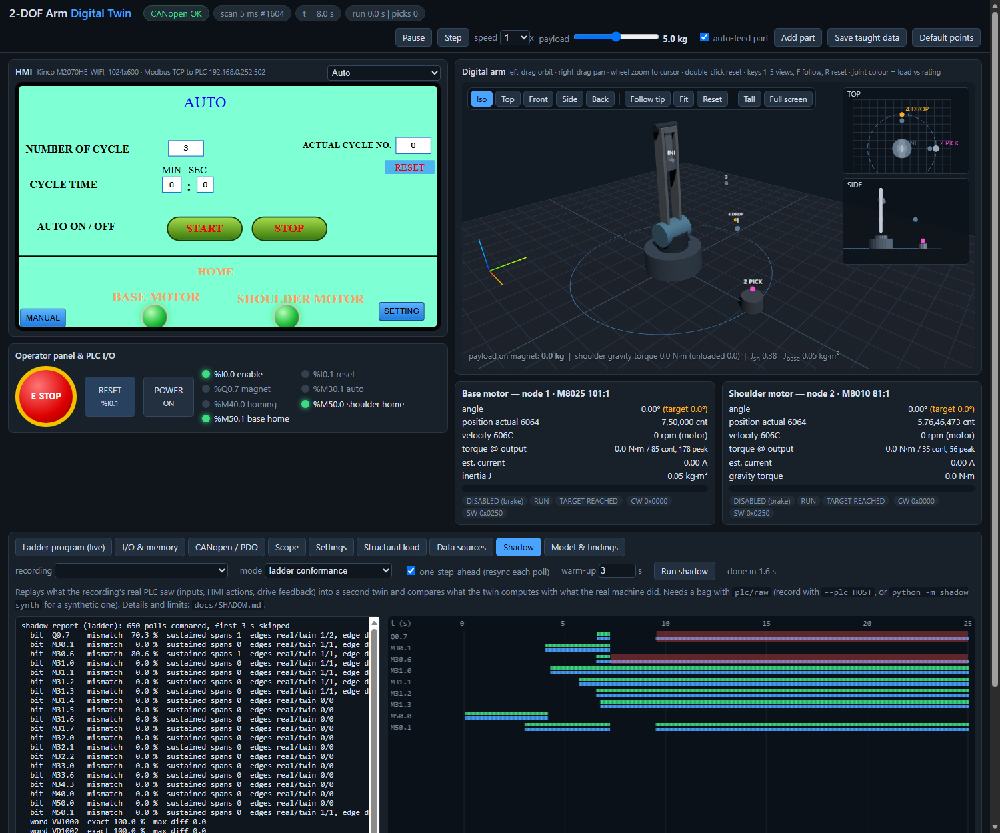

# Shadow-and-diverge toolkit (`shadow/`)

Stage 4 of [MODULAR_BUILD_PLAN.md](MODULAR_BUILD_PLAN.md). Standard library only, no GUI, no hardware. It answers: *given two recordings of the same thing (the real machine and the twin), how far apart are they, when did they start to differ, and by how much?* Research angles that use it: [RESEARCH_ANGLES.md](RESEARCH_ANGLES.md) A1-A8, B1, B3.

## Pipeline
```
bag / snapshots --> Signal --> estimate_lag --> residual --> detectors --> EventLog --> events (bag topic / report)
```

## Signals (`shadow/signals.py`)
`Signal(name, t, v, kind)`: time stamps must not go backwards. `kind="analog"` interpolates linearly, `kind="binary"` holds the last value. `at(t)` returns `None` outside the recorded range (never extrapolates). Build from snapshots or bag messages by path (`/` separates parts because PLC addresses contain dots):
```python
from shadow import from_frames, from_messages
angle = from_frames(frames, "base/deg")                             # frames: snapshots with their own "t"
bit   = from_messages(bag.messages(["plc/decoded"]), "bits/M30.1", clock="t_mono", kind="binary")
```
`clock` is `t_mono` (monotonic, for latency and ordering), `t_wall` (to line up with other PCs) or `payload` (the snapshot's own `t`). Use the **same clock for both sides**; the twin and the PLC snapshots have different `t` (twin time vs unix time), so compare them on `t_mono` or `t_wall`.

## Time alignment (`shadow/align.py`)
Convention: **positive lag = b is later than a**: `b(t) ~ a(t - lag)`.
- `estimate_lag(a, b, max_lag, dt)`: cross-correlation on a grid, refined below the grid step. Returns `LagResult(lag, score, n)`; `score` is the correlation at the best lag (near 1 = the shapes match; below about 0.5 means the signals are not the same thing, do not trust the lag). Tested: known lags of 0.37, -0.82, 0, 2.11 s recovered within 20 ms with 25 % dropped samples, time-stamp jitter and noise.
- `estimate_lag_edges(a, b)` and `edge_delays(...)`: for binary signals; matches rising edges. The per-edge delays are themselves a result (response latency of a PLC bit versus its twin).
- `lag_drift(a, b)`: lag per window and a straight-line fit; `ppm` is the clock-rate difference (tested: 200 ppm recovered within 40 ppm over 10 minutes).
`tools/compare_runs.py` has its own lag search with the opposite sign.

## Residuals (`shadow/residual.py`)
`residual(real, twin, lag, dt)` = `real(t) - twin(t + lag)` on a uniform grid. `Residual.stats()` gives `bias, rms, std, max_abs, t_max, lag`. For bits: `mismatch_intervals(res, min_len)` lists the spans where the two disagree (`min_len` drops disagreements that are only a small edge-timing offset), `mismatch_rate`.

## Detectors (`shadow/detect.py`)
| Detector | Finds | Parameters |
|---|---|---|
| `Threshold(limit, hold_s)` | residual above a limit for at least `hold_s` | limit in signal units |
| `Cusum(k, h, baseline_s)` | small persistent shifts and slow drifts early | `k` allowance and `h` limit in sigma of a baseline window; defaults 0.5 and 10 |
| `WindowRms(window_s, limit)` | sustained error rather than spikes | |
`detect(residual, *detectors)` returns `Alarm`s; `EventLog` merges alarms of the same detector and signal closer than `gap_s` and exports `events()` (dicts with `kind="divergence"`) for the bag `events` topic.
Measured on synthetic data: no false alarm in 600 s of clean white noise at 20 Hz; a 3-sigma step detected within 1 s; a slow ramp found 20 s or more before a fixed threshold. **Real residuals are correlated, so the false-alarm rate will be higher than the white-noise figure**: measure it on clean runs before quoting detection results.


## Shadow engine (`shadow/engine.py`, stage 5)
Drives a second twin from a RECORDED real PLC (`plc/raw` records of a bag, see [BAG_FORMAT.md](BAG_FORMAT.md)) and compares. Command line:
```
python -m shadow report logs/R3.mcap                 # ladder conformance, one-step-ahead (default)
python -m shadow report logs/R3.mcap --no-resync     # ladder conformance, free-running twin (needs a fast poll, about 25 Hz)
python -m shadow report logs/R3.mcap --mode open     # full twin driven by the operator inputs vs the real arm
python -m shadow synth out.mcap --fault latch|timer|slow   # synthetic "real" recording with a seeded fault (no hardware)
```
`--json` writes the full report, `--events-bag` writes the divergence events as a bag (topic `events`).

**Ladder mode** (research angle A1). A second PLC runs the real ladder. Its inputs come from the recording: the physical inputs (`%I0.0` e-stop, `%I0.1` reset), what the HMI writes (buttons, jog, teach, `VD2020`, `VD2030`, `VW2036`) and the drive feedback (positions, status words, velocities, currents). What the ladder COMPUTES (outputs, step flags `M31.x`, drive commands `VD1002`, `VD1028`, ..., counters) is compared with the real values, but only at polls that actually refreshed that value.
- **Analog feedback is interpolated** linearly between polls; everything else is held and changes half-way through the interval. The arm crosses a +-2000 count "reached" window in far less than a 100 ms poll, so a staircase replay would jump over it.
- **Taught points are seeded once**, not fed every scan: the ladder writes them itself (teaching, and the `%VW2400` overlap defect clobbers the low half of `VD2400`).
- `resync=True` (default): after each poll the twin's polled cells are overwritten with the real values, so a missed event costs one poll. `resync=False`: free-running; a missed one-scan event cascades into a long mismatch.
- `%M30.2` (HMI STOP and ladder "complete") is tracked from the recording, not compared.

**Open mode** (A3/A4). A full twin (PLC + drives + arm) is booted and driven only by the operator inputs; after the warm-up its arm pose, taught points and speeds are copied from the real machine once. Arm angles and bits are compared; the constant clock offset is removed first.

**Report.** Per bit: mismatch rate, sustained mismatch spans (longer than `min_len`, default 0.25 s), edge counts, **edge delay** (median delay of the twin's rising edges against the real ones). Per word: exact-match rate. Per angle: bias, rms, max, lag. Alarms: `conformance` (a bit differs for a sustained span, or a word differs in over 2 % of polls), `timing` (a systematic edge delay above 0.15 s and 2.5 poll periods: the twin reaches the same states earlier or later), threshold on angle errors (3 deg for 1 s). `first_divergence` is the earliest alarm, in seconds from the start of the run.

**In the GUI** (Shadow tab, `docs/img/twin/shadow.png`): the server runs the engine on a recording in `logs/` in a background thread (`shadow_run` command, result at `GET /api/shadow`; the 25 Hz stream only carries the state). The tab shows the report text and a chart of the traces, downsampled to at most about 600 samples per signal but always keeping every change; signals that never did anything are left out. Only the base name of the file is used (no path traversal).



**What the synthetic tests show** (`tests/test_shadow_engine.py`, a twin standing in for the PLC):
| Case | Result |
|---|---|
| identical program, 10 Hz, resync | no sustained divergence; at most about 2 % of polls differ by timing |
| identical program, free-running, 10 Hz | cascades (more than 10 alarms): one-scan events are missed |
| identical program, free-running, 25 Hz | holds for 40 s (one harmless event at the very end) |
| real PLC has the e-stop latch patch, shadow does not (25 Hz) | first divergence `M30.6` 70 ms after the e-stop |
| real timer base 20 ms, shadow 10 ms (25 Hz) | `timing` alarm on exactly the two timed steps, "twin earlier by 200 ms" (= timer preset x base difference) |
| real base axis 40 % slower (open mode) | base angle rms above 10 deg, alarm within seconds |
| same model, open mode | angle rms under 1.5 deg, max under 3 deg |

**Limits, stated plainly.**
- Polling is slower than the PLC scan: comparison is state-by-state at poll times. A condition that needs two quantities to be inside windows at the same instant, where one of them moves because of the event itself, cannot be reproduced from samples (found in the first experiments: `M31.4` after the lift to POS1). Resync mode contains this; a higher poll rate reduces it.
- **Record conformance runs at 25 Hz or more** (`--plc-hz 25`) if the Modbus link keeps up (check the Pipeline diagnostics: rate achieved, errors 0). The fast group now includes the whole CANopen PDO area (`V1000..V1063`) so the drive status words are as fresh as the positions.
- Timers and counters inside the interpreter are not in the recorded memory: start recording with the machine idle, or accept the warm-up.
- The synthetic results prove the tool, not the real PLC: the first real recording will show how large the unexplained part is.

## Limits of the toolkit
- Alignment assumes a constant lag over the analysed window; use `lag_drift` to check.
- The cross-correlation needs the signal to change; a flat signal gives score 0.
- Detector baselines come from the start of the run: start recordings with the machine in a normal state.
- Pure Python is fast enough for tens of minutes of 20 Hz data; for hours, thin the data first.
